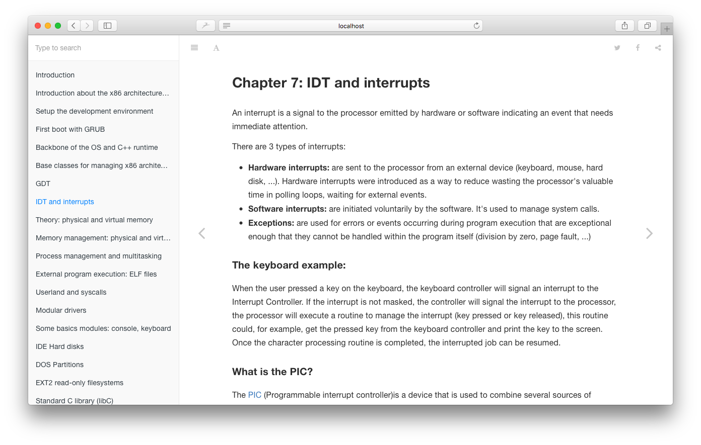

# HonKit Default Theme (Legacy)

This is the default theme for HonKit.

It can be used as a template for theming books or can be extended.



It is based on the GitBook theme.

## License

Apache License

Also, This theme includes GitBook default theme codes.
These are also Apache License.

- https://github.com/GitbookIO/theme-default

## Development

```sh
# Build _assets/ (JavaScript and CSS with esbuild)
pnpm --filter @honkit/honkit-plugin-theme-default run build
# Run the E2E tests of the theme
pnpm run test:e2e
```

Stylesheets are plain CSS in `src/css/`. `src/css/website.css`, `ebook.css`, `epub.css`, `mobi.css` and `pdf.css`
are the entry points, and their `@import`s are bundled into one file per output.
Values are written as they are (the theme had no runtime variables), so a custom theme can still override
any rule with a more specific or later selector.

The theme's own scripts do not depend on jQuery.
jQuery is still bundled into `gitbook.js` and exposed as `window.$`, `window.jQuery` and `require(["jquery"])`
because existing GitBook/HonKit plugins use it.

### Script loading

`gitbook.js`, `theme.js` and the scripts of plugins are loaded with `defer`, so they do not block rendering.
They run in the same order as before, after the HTML is parsed and before `DOMContentLoaded`.

`boot.js` is the only synchronous script. It restores the sidebar state before the first paint and,
until `gitbook.js` runs, queues these calls from inline scripts:

- `gitbook.push(fn)`
- `require(["gitbook", "jquery"], fn)`: called after the plugin scripts ran, like before
- `$(fn)` / `jQuery(fn)`: called when the page is ready

If a custom layout adds an inline script that uses jQuery directly (e.g. `$(".book").addClass(...)`),
wrap it with `$(function () { ... })` or `require(["jquery"], function ($) { ... })`.
